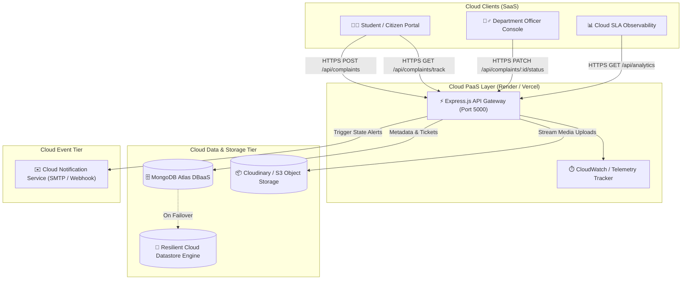

# Cloud-Based Online Complaint Management System ☁️🏛️

> **Subject:** Cloud Technology (Semester 5 Micro-Project)  
> **Student:** Lucky Biswal  
> **Repository:** [https://github.com/luckybiswal98210-eng/CT--Minor](https://github.com/luckybiswal98210-eng/CT--Minor)  
> **Status:** Production-Ready & Cloud-Deployable  

---

## 📌 Executive Summary & Problem Statement

Traditional grievance systems rely on paper forms or on-premise single-server applications that suffer from single points of failure, unmonitored SLA breaches, local disk saturation due to attachments, and lack of real-time visibility.

This project delivers a **Cloud-Native Grievance Redressal Platform** engineered to demonstrate key **Cloud Computing service models and architectures**:
- **SaaS (Software as a Service):** Responsive, modern Citizen Portal and Officer Triage Console.
- **PaaS (Platform as a Service):** Node.js runtime deployed on elastic cloud hosts (Render / Vercel).
- **DBaaS (Database as a Service):** MongoDB Atlas multi-AZ cloud replica set with automatic failover and local resilient cloud-emulated datastore fallback.
- **Cloud Object Storage:** Decoupled storage for evidence media (images, PDFs) via Cloudinary CDN / AWS S3 buckets.
- **MaaS / FaaS (Notification as a Service):** Cloud email and webhook event dispatchers for real-time ticket state transitions.
- **IaaS / CaaS (Container as a Service):** Docker and Docker Compose containerization for cloud orchestration.

---

## 🏗️ Cloud Service Model Mapping (SPI Framework)

| Cloud Model | Component in this Project | Cloud Provider / Technology |
| :--- | :--- | :--- |
| **SaaS** | Citizen Portal, Admin Console, SLA Observability Dashboard | Browser-accessible Web Application |
| **PaaS** | Node.js Express REST API runtime with auto-scaling | Render, Vercel, Railway |
| **DBaaS** | Managed NoSQL Document Database Cluster | MongoDB Atlas (Multi-AZ Replica Set) |
| **Object Storage** | Evidence images/PDFs streaming & CDN edge delivery | Cloudinary / AWS S3 S3-compatible bucket |
| **MaaS / FaaS** | Automated email dispatch on ticket submission & resolution | SMTP / Cloud Webhook Event Queue |
| **IaaS / CaaS** | Containerized image packaging & orchestration | Docker & Docker Compose |

---

## 📐 System Architecture Diagram



---

## 🚀 Key Features

1. **Self-Service Citizen Portal:**
   - Lodge complaints across 7 campus departments (IT, Academic, Hostel, Sanitation, Transport, Security, Admin).
   - Priority-based SLA commitments:
     - 🔴 **Urgent:** 6-Hour SLA
     - 🟠 **High:** 24-Hour SLA
     - 🟡 **Medium:** 48-Hour SLA
     - 🟢 **Low:** 72-Hour SLA
   - Upload evidence files (photos, bills, PDFs up to 10MB) directly streamed to Cloud Object Storage.
   - Auto-generated Cloud Tracking ID (e.g., `CMP-2026-1042`).

2. **Real-Time Step-by-Step SLA Tracker:**
   - Live visual stepper (`Submitted` $\rightarrow$ `Under Review` $\rightarrow$ `In Progress` $\rightarrow$ `Resolved`).
   - Direct link to view evidence hosted on Cloud CDN.
   - Officer resolution notes.
   - Complainant 5-star satisfaction rating widget.

3. **Officer Triage & Department Console:**
   - Multi-parameter live search and filters (Status, Category, Priority).
   - Assign handling officers and departments.
   - Status transitions with automated cloud audit logs.

4. **Cloud Infrastructure Observability & SLA Analytics:**
   - Interactive Chart.js graphs (Ticket pipeline, Priority breakdown, Department volume).
   - Real-time cloud health metrics (Region, Memory RSS, Uptime, DBaaS State, Cloud Event Stream).

5. **Zero-Configuration Fault-Tolerant Engine:**
   - If MongoDB Atlas or Cloudinary keys are not provided, the application automatically activates **Cloud-Emulated resilient storage** so the project runs immediately with zero crashes!

---

## 🛠️ Technology Stack

- **Runtime & Backend:** Node.js (v20+), Express.js
- **Cloud Database:** MongoDB Atlas (Mongoose ODM) + Local Resilient File Adapter
- **Cloud Storage:** Cloudinary SDK + Multer
- **Observability & Charts:** Chart.js, Lucide Icons, Custom CSS Glassmorphism
- **Containerization:** Docker (Alpine), Docker Compose

---

## ⚡ Quick Start & Local Setup

### 1. Clone Repository
```bash
git clone https://github.com/luckybiswal98210-eng/CT--Minor.git
cd CT--Minor
```

### 2. Install Dependencies
```bash
npm install
```

### 3. Environment Variables (Optional)
The system comes with sensible defaults. To plug in production cloud credentials:
```bash
cp .env.example .env
```
Edit `.env`:
```env
PORT=5000
MONGODB_URI=mongodb+srv://<username>:<password>@cluster0.xxx.mongodb.net/cloud_complaints?retryWrites=true&w=majority
CLOUDINARY_CLOUD_NAME=your_cloud_name
CLOUDINARY_API_KEY=your_api_key
CLOUDINARY_API_SECRET=your_api_secret
```

### 4. Run the Application
```bash
npm start
```
Navigate to:
- **Citizen Grievance Portal:** [http://localhost:3000](http://localhost:3000)
- **Admin & Department Console:** [http://localhost:3000/admin.html](http://localhost:3000/admin.html)
- **Cloud SLA Observability Dashboard:** [http://localhost:3000/analytics.html](http://localhost:3000/analytics.html)
- **Viva Guide & Architecture Page:** [http://localhost:3000/architecture.html](http://localhost:3000/architecture.html)

---

## 🐳 Docker Deployment (IaaS / CaaS)

To run the application inside Docker:

```bash
docker-compose up --build
```
Access the application on `http://localhost:5000`.

---

## ☁️ 1-Click Free Cloud Deployment (Render PaaS)

1. Fork or push this repository to your GitHub account (`CT--Minor`).
2. Go to [Render.com](https://render.com) and click **New + > Web Service**.
3. Select your repository `CT--Minor`.
4. Runtime: `Node`, Build Command: `npm install`, Start Command: `npm start`.
5. Render automatically deploys your project with free SSL (`https://your-app.onrender.com`).

---

## 📚 Viva Voce Preparation Guide (Semester 5 Cloud Technology)

Refer to `/architecture.html` in the running application for full interactive answers to the top 10 viva questions:
1. **SPI Service Model Mapping:** Explain SaaS, PaaS, and DBaaS implementation.
2. **Object Storage vs. DB BLOBs:** Why media belongs in S3/Cloudinary, not inside tables.
3. **High Availability (HA) & Disaster Recovery (DR):** Multi-AZ replication and failover.
4. **SLA Monitoring:** Priority-based resolution metrics.
5. **Horizontal Scaling:** Auto-scaling groups, load balancing, and containerization.

---

## 👨‍💻 Author

- **Lucky Biswal**  
- **Subject:** Cloud Technology (Semester 5 Micro-Project)  
- **GitHub:** [@luckybiswal98210-eng](https://github.com/luckybiswal98210-eng)
